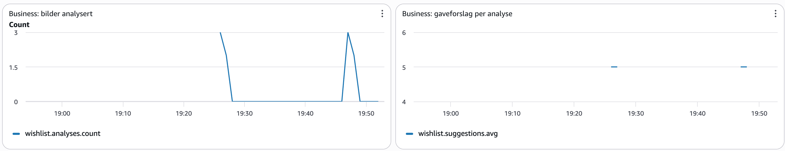
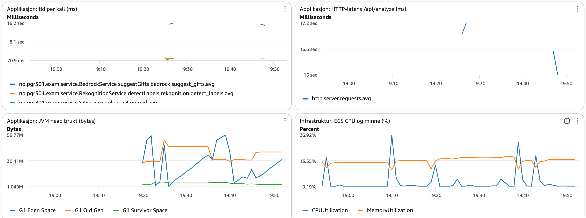

# Besvarelse PGR301 Eksamen 2026

## Oppgave 1A — Container

Multi-stage Dockerfile: første steg bygger JAR-filen med Maven og JDK, andre steg inneholder kun JRE og den ferdige JAR-filen. Build-verktøy og kildekode blir dermed ikke med i det endelige imaget.

Bygg og kjør (lytter på localhost:9999):

```bash
docker build -t wishifai .
docker run -p 9999:8080 \
  -e AWS_ACCESS_KEY_ID=<din-nøkkel> \
  -e AWS_SECRET_ACCESS_KEY=<din-hemmelige-nøkkel> \
  -e AWS_REGION=eu-west-1 \
  -e S3_BUCKET=<bucket-navn> \
  wishifai
```

Test: `curl http://localhost:9999/api/health`

## Oppgave 1B — CI-pipeline

Workflow: `.github/workflows/deploy.yml`
Url for kjøring: https://github.com/Kelvin-Tang04/PGR301-eksamen-2026/actions/runs/41489052079

**Tagging-strategi:** Imaget tagges med commit-SHA (`github.sha`). Hver tag er dermed unik og kan spores direkte tilbake til commiten den er bygget fra, slik at man alltid vet hvilken kode som kjører hvor. Det gjør også rollback enkelt, fordi man kan deploye et tidligere image ved å angi en eldre SHA. `latest` brukes ikke, fordi den alltid peker på siste push og ikke sier noe om hvilken versjon som faktisk kjører. 

## Oppgave 2A — Infrastruktur for tjenesten

Terraform-koden ligger i `infra/` og oppretter en ECS Express-tjeneste, en S3-bucket for bilder og en task-rolle for applikasjonen.

Offentlig URL: https://wi-37426755399142ab86e99763799ac9cf.ecs.eu-west-1.on.aws

**ECS Express:** Express oppretter load balancer, nettverk og auto-scaling automatisk, slik at tjenesten får et offentlig endepunkt uten manuelt oppsett av infrastruktur.

**Roller:** Tjenesten bruker de eksisterende execution- og infrastructure-rollene. Task-rollen `wishifai-task-role-6` opprettes i Terraform og gir applikasjonen kun tilgangene den trenger: `s3:PutObject` på egen bucket, `rekognition:DetectLabels`, `bedrock:InvokeModel` og `cloudwatch:PutMetricData`.

**Konfigurasjon:** `S3_BUCKET` settes automatisk til bucketen Terraform oppretter. Region, kandidatnummer og image-tag er variabler, og URL-en eksponeres som output. Health check peker på `/api/health`, siden applikasjonen ikke svarer på `/`.

## Oppgave 2B — Remote state

Terraform-state lagres i den delte S3-bucketen `pgr301-terraform-state` med nøkkelen `wishifai/6/terraform.tfstate`. Kandidatnummeret i nøkkelen gjør state-filen unik, slik at den ikke kolliderer med andre kandidater. `use_lockfile` låser state under kjøring, slik at to samtidige kjøringer ikke overskriver hverandre.

## Oppgave 2C — Terraform i pipeline

Workflowen har to jobber: `build-push` bygger og pusher imaget til ECR, og `deploy` kjører `terraform fmt -check`, `init` og `apply` mot `infra/`. `deploy` er avhengig av `build-push` via `needs:`.

Grønn kjøring: https://github.com/Kelvin-Tang04/PGR301-eksamen-2026/actions/runs/41667324023

**Hvorfor Terraform kjører etter container-build:** Terraform deployer tjenesten med image-taggen fra samme commit. Kjørte Terraform før eller parallelt med bygget, kunne ECS forsøke å starte et image som ennå ikke finnes i ECR, og deployen ville feilet. Med `needs:` blir Terraform bare kjørt hvis bygget og pushen lyktes.

## Oppgave 3A — Metrikker i applikasjonen

Metrikkene publiseres til CloudWatch i namespacet `wishifai-6-l`.

- `bedrock.suggest_gifts`, `rekognition.detect_labels` og `s3.upload` (Timer): måler tiden for hvert eksterne kall, slik at det er mulig å se hvilket steg som gjør tjenesten treg.
- `wishlist.analyses` (Counter): antall analyserte bilder, som viser hvor mye tjenesten brukes.
- `wishlist.suggestions` (DistributionSummary): antall gaveforslag per analyse, som viser om Bedrock leverer det forventede antallet forslag (inntil 5).
- `wishlist.labels` (DistributionSummary): antall objekter Rekognition finner per bilde, som sier noe om hvor godt grunnlag Bedrock får. Denne er ikke med i dashboardet, men er tilgjengelig i CloudWatch.

## Oppgave 3B — Dashboard og alarm

**Terraform-kode:** `infra/dashboard.tf` og `infra/alarm.tf`

**Dashboard:** `wishifai-6-l`




**Begrunnelse for metrikkene:**
- **Business:** Antall analyserte bilder og gaveforslag per analyse viser bruken av tjenesten og hva brukeren får ut av den.
- **Applikasjon:** Tidsbruk for Bedrock, Rekognition og S3 viser hvilket steg som påvirker svartiden mest. HTTP-latens og JVM-heap fra Spring Boot Actuator viser svartiden brukeren opplever og minnebruken i applikasjonen.
- **Infrastruktur:** CPU- og minneutnyttelse for ECS-tjenesten viser om containeren er tilstrekkelig dimensjonert.

**Hvor blir tiden av:**
- Bedrock-kallet tar om lag 16 sekunder, mens Rekognition og S3 tar under 0,1 sekund hver.
- Den totale svartiden for `/api/analyze` er om lag 17 sekunder, så Bedrock står for over 90 % av den.
- CPU-bruken når bare om lag 27 % under analyse, minnebruken ligger stabilt rundt 14 %, og JVM-heap viser normal søppeltømming. Containeren er dermed ikke flaskehalsen.
- Konklusjon: tjenesten er treg på grunn av Bedrock-kallet, ikke infrastrukturen. Å skalere containeren vil ikke hjelpe. Forbedringer må rettes mot Bedrock, for eksempel en kortere prompt, en raskere modell eller strømming av svaret.

**Begrunnelse for alarmen:**
- **Hva:** `wishifai-6-l-bedrock-latency` varsler på e-post via SNS når det tregeste Bedrock-kallet innenfor ett minutt overstiger 20 sekunder.
- **Hvorfor:** Bedrock står for over 90 % av den totale svartiden og har derfor størst innvirkning på brukeropplevelsen.
- **Terskel:** Normal tidsbruk er om lag 16 sekunder. Terskelen på 20 sekunder gir margin mot naturlig variasjon, slik at alarmen kun utløses ved en reell forverring.